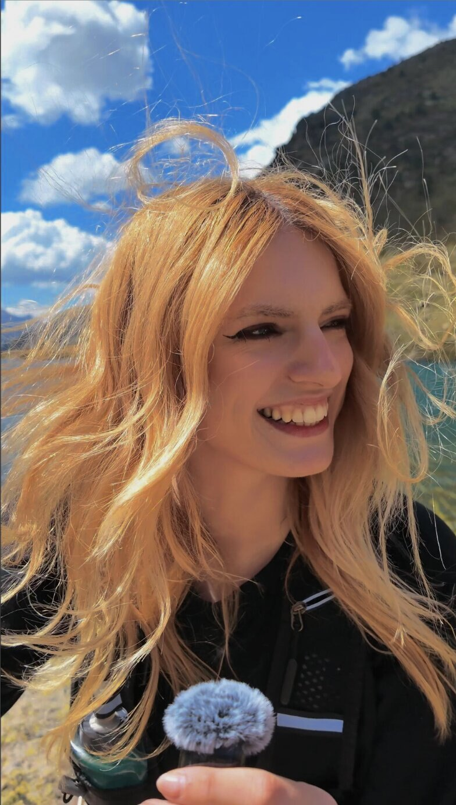

<!--
  PÁGINA DE ENLACES (para la bio de TikTok, Instagram…)
  Dirección: https://ecosdenuestrosclasicos.com/enlaces/
  Para añadir un enlace, copia una línea <a class="enlace">…</a> y cambia el texto y la dirección.
  El orden de la lista es el orden en que salen.
-->

```{=html}
<div class="enlaces">
  <div class="enlaces-mapa" role="img" aria-label="Detalle del mapa ilustrado de Ecos"></div>

  <header class="enlaces-cabecera">
    
    <h1>Ecos de nuestros clásicos</h1>
    <p>Grecia y Roma leídas despacio, con las fuentes delante.<br>Un proyecto de Isabel Sanz.</p>
  </header>

  <nav class="enlaces-lista" aria-label="Enlaces de Ecos">
    <a class="enlace destacado" href="https://paypal.me/ecosclasicos">
      <span class="enlace-titulo">Apoya el proyecto</span>
      <span class="enlace-sub">Una aportación puntual por PayPal</span>
    </a>
    <a class="enlace" href="https://www.instagram.com/ecosdenuestrosclasicos/">
      <span class="enlace-titulo">Instagram</span>
      <span class="enlace-sub">Vídeos cortos y carruseles</span>
    </a>
    <a class="enlace" href="https://ecosdenuestrosclasicos.com/">
      <span class="enlace-titulo">La web de Ecos</span>
      <span class="enlace-sub">Investigaciones, lecturas, fuentes y comunidad</span>
    </a>
    <a class="enlace" href="../suscribete.html">
      <span class="enlace-titulo">La newsletter de los lunes</span>
      <span class="enlace-sub">Lo que trae la semana y lo que pasó tal día como estos</span>
    </a>
    <a class="enlace" href="https://www.patreon.com/cw/Ecosdenuestrosclasicos">
      <span class="enlace-titulo">Patreon</span>
      <span class="enlace-sub">El rincón tranquilo, cada mes</span>
    </a>
    <a class="enlace" href="https://www.youtube.com/@Ecosdenuestrosclásicos">
      <span class="enlace-titulo">YouTube</span>
      <span class="enlace-sub">Episodios largos y lecturas</span>
    </a>
    <a class="enlace" href="https://www.tiktok.com/@ecosdenuestrosclasicos">
      <span class="enlace-titulo">TikTok</span>
      <span class="enlace-sub">Vídeos cortos</span>
    </a>
    <a class="enlace" href="https://www.facebook.com/profile.php?id=61586532315391">
      <span class="enlace-titulo">Facebook</span>
      <span class="enlace-sub">Vídeos y publicaciones</span>
    </a>
    <a class="enlace" href="../libro.html">
      <span class="enlace-titulo">El libro</span>
      <span class="enlace-sub">Hay una palabra secreta. ¿Qué crees que es?</span>
    </a>
    <a class="enlace" href="../comunidad.html">
      <span class="enlace-titulo">Propón un tema o recomienda una lectura</span>
      <span class="enlace-sub">La comunidad de Ecos</span>
    </a>
    <a class="enlace" href="mailto:ecosdenuestrosclasicos@gmail.com">
      <span class="enlace-titulo">Escríbeme</span>
      <span class="enlace-sub">ecosdenuestrosclasicos@gmail.com</span>
    </a>
  </nav>

  <p class="enlaces-pie">Mini Odi también anda por aquí. Búscalo.</p>
</div>
```
