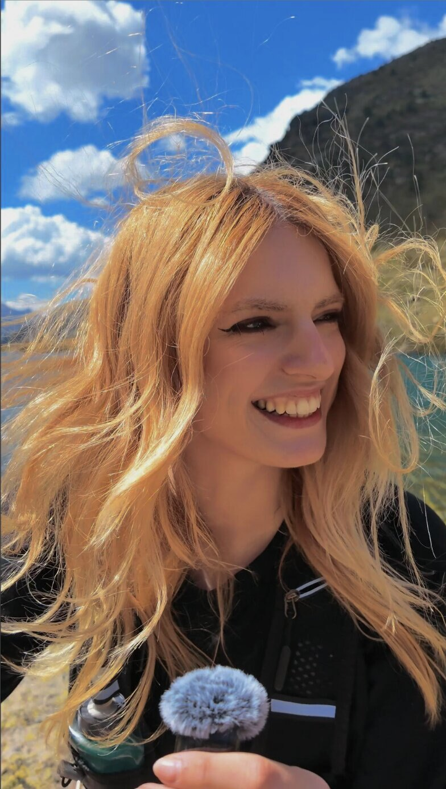

```{=html}
<div class="portada">

<header class="portada-cabecera">
  <p class="portada-firma">Un proyecto de Isabel, en marcha desde el 23 de noviembre de 2025</p>
  <h1 class="portada-titulo">Ecos de nuestros clásicos</h1>
  <p class="portada-entrada">Grecia y Roma leídas despacio: cómo se organizaban, cómo se justificaba el poder, qué escribieron sus autores y qué preguntas nos siguen dejando. Con las fuentes delante y, cuando toca, con humor.</p>
</header>

```



```{=html}

<section class="paradas" aria-labelledby="paradas-titulo">
  <h2 id="paradas-titulo">Qué vas a encontrar aquí</h2>
  <svg class="paradas-ruta" viewBox="0 0 1000 40" preserveAspectRatio="none" aria-hidden="true">
    <path d="M6 24 C 150 14, 260 30, 420 22 S 720 12, 994 24" />
  </svg>
  <ul class="paradas-lista">
    <li><a href="proyecto.html"><span class="parada-nombre">El proyecto</span></a>
      <p>Qué es Ecos, de dónde sale y por qué no creo que los clásicos tengan respuesta para todo.</p></li>
    <li><a href="biblioteca.html"><span class="parada-nombre">La biblioteca</span></a>
      <p>El archivo: investigaciones, lecturas y textos, ordenados por temas y con buscador.</p></li>
    <li><a href="investigacion.html"><span class="parada-nombre">Investigación</span></a>
      <p>Donde la filología se encuentra con R: datos, recuentos de palabras y mucho Salustio.</p></li>
    <li><a href="lecturas.html"><span class="parada-nombre">Lecturas y fuentes</span></a>
      <p>Los autores que leo, las ediciones que uso y dónde puedes leerlos tú.</p></li>
    <li><a href="videos.html"><span class="parada-nombre">Vídeos</span></a>
      <p>Las series del canal, con el material que no cabe en un minuto y medio.</p></li>
    <li><a href="comunidad.html"><span class="parada-nombre">Comunidad</span></a>
      <p>Para proponer temas, preguntar y, sobre todo, discrepar con argumentos.</p></li>
  </ul>
</section>

<section class="destacado" aria-labelledby="destacado-titulo">
  <div class="destacado-cita">
    <p class="original" lang="la">Iam pridem equidem nos vera vocabula rerum amisimus.</p>
    <p class="traduccion">Hace ya tiempo que perdimos los verdaderos nombres de las cosas.</p>
    <p class="referencia">Catón, en Salustio, <cite>Bellum Catilinae</cite> 52.11</p>
  </div>
  <div class="destacado-texto">
    <p class="destacado-tipo"><span class="sello terminado">Investigación terminada</span></p>
    <h2 id="destacado-titulo">Cuando una república se queda sin palabras</h2>
    <p>Catón se queja en el Senado de que en Roma ya nadie llama a las cosas por su nombre: regalar lo ajeno se llama generosidad y la audacia para el mal, valentía. Mi trabajo de fin de grado partió de ahí. Leí la <cite>Conjuración de Catilina</cite> de Salustio contando palabras (discordia, avaricia, Senado, república) para ver cómo cambia el vocabulario político de un texto que habla, precisamente, de una república que se deteriora.</p>
    <p><a class="boton" href="investigacion/salustio-catilina.html">Leer la ficha del trabajo</a></p>
  </div>
</section>

<section class="presentacion" aria-labelledby="presentacion-titulo">
  <figure class="foto-marco presentacion-foto">
    
  </figure>
  <div class="presentacion-texto">
    <h2 id="presentacion-titulo">Soy Isabel</h2>
    <p>Estudié Economía, pasé antes por Filología Clásica y ahora ando entre un máster de Economía y el grado de Matemáticas. Suena a no saber elegir, y algo de eso hay, pero es justo lo que me permite mirar Roma con un diccionario de latín en una mano y RStudio en la otra.</p>
    <p>Grabo vídeos, leo mucho, me equivoco a veces y lo corrijo en público. Y hablo de instituciones con la misma ilusión con la que comento los cotilleos que Suetonio cuenta de los emperadores.</p>
    <p><a href="sobre-mi.html">Más sobre mí</a></p>
  </div>
</section>

<section class="preguntas" aria-labelledby="preguntas-titulo">
  <h2 id="preguntas-titulo">Dos preguntas para pensar despacio</h2>
  <div class="preguntas-rejilla">
    <article class="cita">
      <p class="original" lang="grc">κτῆμά τε ἐς αἰεὶ μᾶλλον ἢ ἀγώνισμα ἐς τὸ παραχρῆμα ἀκούειν ξύγκειται.</p>
      <p class="traduccion">Está compuesta como una adquisición para siempre, más que como una pieza de concurso para ser escuchada en el momento.</p>
      <p class="referencia">Tucídides, <cite>Historia de la guerra del Peloponeso</cite> 1.22.4</p>
      <p class="pregunta">Tucídides escribe para lectores que todavía no existen. ¿Qué pasa con una historia pensada para durar cuando todo lo que leemos está hecho para consumirse hoy?</p>
    </article>
    <article class="cita">
      <p class="original" lang="la">Concordia parvae res crescunt, discordia maximae dilabuntur.</p>
      <p class="traduccion">Con la concordia crecen las cosas pequeñas; con la discordia se desmoronan las más grandes.</p>
      <p class="referencia">Micipsa, en Salustio, <cite>Bellum Iugurthinum</cite> 10.6</p>
      <p class="pregunta">Lo dice un rey moribundo a sus herederos, que acabarán matándose entre ellos. ¿Basta con saber que la discordia destruye para evitarla?</p>
    </article>
  </div>
</section>

<section class="patreon" aria-labelledby="patreon-titulo">
  <div class="patreon-texto">
    <h2 id="patreon-titulo">Un rincón más tranquilo</h2>
    <p>En Instagram y TikTok todo va deprisa. En Patreon puedo dedicar más tiempo a las lecturas, a los textos largos y a las conversaciones que en redes se quedan a medias. Si te apetece acompañar el proyecto desde ahí, me ayudas a mantenerlo independiente y a seguir leyendo e investigando con calma.</p>
    <p><a class="boton lleno" href="https://www.patreon.com/cw/Ecosdenuestrosclasicos">Ir a Patreon</a>
       <a class="patreon-mas" href="apoyame.html">Qué significa apoyar Ecos</a></p>
  </div>
</section>

</div>
```
