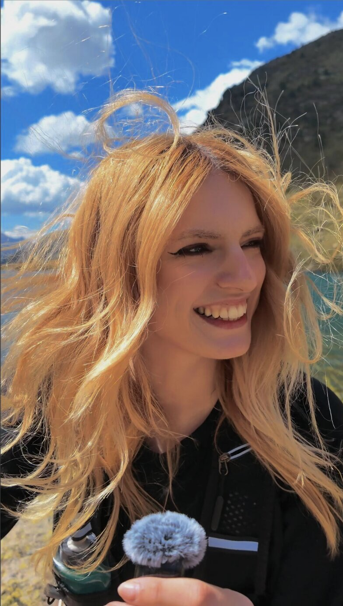

:::: {.sobre-mi}

::: {.sobre-mi-foto}
```{=html}
<figure class="foto-marco">
  
</figure>
<p class="pie-foto">Grabando al aire libre. El viento no estaba invitado.</p>
```
:::

::: {.sobre-mi-texto .capitular}
Me llamo Isabel Sanz, vivo en la provincia de Valencia y soy la persona que hay detrás de Ecos de nuestros clásicos.

Soy economista. Me gradué en Economía por la Universitat de València, y antes estudié Filología Clásica, que me dio la base de todo lo demás: de ahí me traje el latín, el griego y la manía de ir siempre al texto original. Ahora curso el Máster en Economía, también en la Universitat de València, y el grado en Matemáticas en la UNED.

Contado así parece un camino con muchas curvas, pero para mí tiene toda la lógica. La filología me enseñó a leer despacio, la economía a preguntarme por qué unas instituciones funcionan y otras no, y las matemáticas a comprobar si lo que creo ver en un texto está de verdad ahí. Casi todo lo que hago en Ecos sale de juntar esas tres cosas.
:::

::::

## Lo que me interesa

Quiero entender por qué las sociedades confían en sus instituciones y por qué dejan de hacerlo. Por eso me paso el día entre la economía institucional, la historia económica, el pensamiento político y la historia de las instituciones, y Roma es mi laboratorio favorito para todo eso.

Cada vez me engancha más el análisis cuantitativo de textos. Contar palabras, ver con qué otras aparecen y seguir cómo cambia el lenguaje político de un autor o de una época. Trabajo con R y RStudio, y esta web también está hecha con ellos.

Me gustaría seguir investigando y hacer un doctorado. Mientras tanto, lo que voy haciendo lo tienes en [Investigación](investigacion.qmd).

## Cómo soy en Ecos

Soy alguien que lee, se hace preguntas y comparte lo que va encontrando, de igual a igual. A veces me equivoco, y cuando alguien me lo señala con argumentos, lo agradezco y lo corrijo.

Puedo pasarme una tarde con las instituciones de la República tardía y grabar al día siguiente un vídeo sobre las manías de un emperador. Las dos cosas salen de la misma curiosidad.

## Y Mini Odi

Mini Odi es mi pequeño compañero de aventuras, un pato que tejí yo misma a ganchillo y que tiene muy buen gusto para las camisetas. En el mapa de la portada corre detrás de mí con su capa y su corona de laurel, y en cualquier página de la web te lo puedes encontrar en una esquina. Si le haces clic, te dice algo. Y si lo arrastras, se va contigo a donde quieras.

```{=html}
<p style="margin-top:2.5rem">
  <a class="boton" href="contacto.html">Escríbeme</a>
</p>
```
